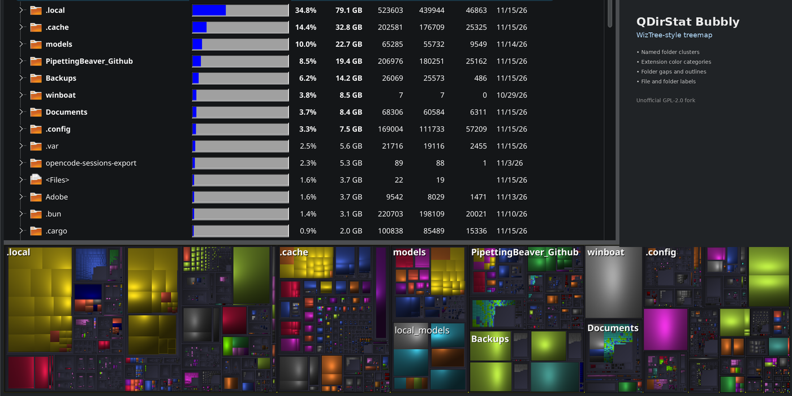

# QDirStat Bubbly



**QDirStat Bubbly** is an unofficial fork of [QDirStat 2.0](https://github.com/shundhammer/qdirstat)
by Stefan Hundhammer, adding a WizTree-style treemap experience.

It is **not affiliated with or endorsed by** the QDirStat project or its author.

## What changed

- Cushion-shaded treemap with extension-based color categories.
- WizTree, Colorblind, and Muted color palettes.
- Color modes for MIME category, file extension, top-level folder, and file size.
- Visible folder gaps and depth-weighted folder outlines.
- Names on large folder clusters and large files.
- A **Treemap** tab in the configuration dialog with a WizTree preset.
- Color swatches in the File Type Statistics window.
- High-DPI-aware cushion rendering.

## Install

### Arch / CachyOS package

Download the latest `.pkg.tar.zst` from the
[releases page](https://github.com/PipettingBeaver/qdirstat-bubbly/releases/latest),
then install it:

```bash
sudo pacman -U qdirstat-bubbly-2.0-2-x86_64.pkg.tar.zst
qdirstat
```

The package provides and conflicts with `qdirstat`, so it replaces the stock
package.

### Build from source

Requires Qt 6, `qt6-5compat`, `make`, and `gcc`.

```bash
qmake6
make -j"$(nproc)"
sudo make install
```

## Configuration

Open **Edit → Configure QDirStat → Treemap**. The **Use WizTree defaults**
button enables cushion shading, extension colors, folder gaps, folder
outlines, and labels. **Folder gap**, **Folder gap max depth**, and
**Label minimum size** control the cluster separation and label density.

## License

GPL-2.0-only. See [LICENSE](LICENSE) and [NOTICE](NOTICE). The original
QDirStat copyright notices are preserved, and modified files carry change
notices.

## Upstream

The unmodified upstream README is kept as [README-upstream.md](README-upstream.md).
Upstream project: https://github.com/shundhammer/qdirstat
